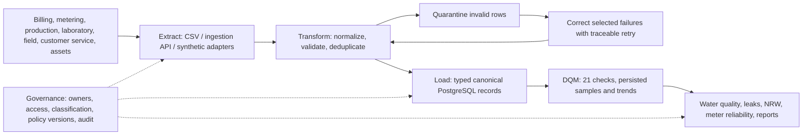

# Integration PowerPoint review — Water Hub

Reviewed on 27 October 2026 against the supplied `integration.pptx`: all 19 slides, including the diagram embedded in slide 13. This review applies its EDM concepts to the existing water-utility project. It does not treat every illustrated industry, law or integration method as a feature that the prototype implements.

## Requirement coverage

| Deck reference                                        | What the project demonstrates                                                                                                                                                                                      | Evidence and limits                                                                                                                                                                                        |
| ----------------------------------------------------- | ------------------------------------------------------------------------------------------------------------------------------------------------------------------------------------------------------------------ | ---------------------------------------------------------------------------------------------------------------------------------------------------------------------------------------------------------- |
| Slides 2–3: integration, governance and DQM together  | Seven registered source systems feed typed canonical water records; governance and DQM operate on those same records.                                                                                              | Source catalog, import history, operations, governance and quality screens; API-backed overview.                                                                                                           |
| Slides 4–7: extract, transform, load                  | CSV and JSON ingestion through REST endpoints; in-process synthetic provider snapshots; trimming, uppercase account/meter identifiers, numeric validation and timezone normalization before canonical persistence. | `backend/src/modules/integrations/` and `canonical/`; tests cover malformed rows, references and normalized values. External providers are simulated.                                                      |
| Slide 6: deduplication and correction                 | Natural source keys, payload hashes, idempotent replay, quarantine and selected corrected retry prevent repeated imports from duplicating successful rows.                                                         | Integration tests and walkthrough checkpoints 5–9. Invalid data is quarantined rather than silently fabricated.                                                                                            |
| Slides 3, 12–13: cleansing, validation and monitoring | Twenty-one executable DQM checks; persisted observations, readable failure samples, remediation reasons and real trend history.                                                                                    | Every registered rule is tested against valid data and a targeted defect. Acknowledging a finding leaves its historical score unchanged.                                                                   |
| Slides 9, 12–13: governance and security              | Ownership/stewardship, classification, retention metadata, organization/domain permissions, customer masking, audited policy versions and immutable audit events.                                                  | Integration and eight-role access tests cover forbidden operations, forged roles, foreign identifiers and session handling. Retention metadata does not constitute an automatic erasure service.           |
| Slides 7, 9, 12: useful outcomes                      | Water-quality breaches, active leaks, DMA water balance/NRW with record lineage, meter reliability and CSV reports.                                                                                                | Local walkthrough reconciles NRW totals and proves a completed repair resolves its linked leak and reduces the active count.                                                                               |
| Slide 8: integration options                          | The implemented approach is bounded batch ETL plus request/response ingestion APIs and synthetic adapters.                                                                                                         | CDC, data virtualization, a warehouse ELT service, data fabric/iPaaS and live provider synchronization are not implemented.                                                                                |
| Slides 10, 12: resilience and scale                   | Pagination, 500-record import caps, source leases, idempotency, transactional integrity and snapshot-based quality evaluation.                                                                                     | Tests cover lock contention and failed executions. Enterprise load, distributed throughput and multi-cloud operation have not been established.                                                            |
| Slide 19: presentation activity                       | The flowchart and comparative matrix below make the required source → method → governance → output mapping explicit.                                                                                               | Water utilities are the user's selected domain. The activity names Healthcare, Banking, Retail, Manufacturing and Education; the alternative domain needs instructor acceptance if that list is mandatory. |

## Water-utility flowchart

## Comparative matrix for the presentation

| Project / industry                        | Sources                                                                                     | Implemented integration                                                      | Governance                                                                                                       | Outputs                                                                           |
| ----------------------------------------- | ------------------------------------------------------------------------------------------- | ---------------------------------------------------------------------------- | ---------------------------------------------------------------------------------------------------------------- | --------------------------------------------------------------------------------- |
| Water Hub / water utilities               | Billing, metering, production, laboratory, field response, customer service, asset registry | CSV/JSON ingestion APIs; synthetic adapters; canonical ETL; quarantine/retry | Domain-scoped roles; customer masking; lab/billing retention guards; owners and immutable audit                  | Water-quality/leak overview; NRW lineage; meter reliability; CSV reports          |
| Waste Hub / municipal waste and recycling | Collection, fleet, weighbridge, recovery, work orders, contracts, citizen service           | CSV/JSON ingestion APIs; synthetic adapters; canonical ETL; quarantine/retry | Organization-scoped roles; citizen identity masking; owners/classification; versioned policy and immutable audit | Collection reliability; missed stops; recovery/diversion; operational CSV reports |

## Final verification

- Architecture, full lint and backend/frontend/tools TypeScript checks passed. The changed walkthrough also passed targeted lint and tools TypeScript checks.
- Unit tests: **13 passed**. Disposable local PostgreSQL integration tests: **42 passed**. Local access/security tests: **46 passed**.
- Backend and Next.js production builds passed from the independent Desktop project.
- The local HTTP walkthrough passed **22 checkpoints**, including all eight role sign-ins, imports, DQM, correction, governance, repair, export, audit and logout.
- Fixed a repeatability failure: the walkthrough previously assumed seeded repair `LK-301` was still open. It now imports a uniquely identified leak linked to the current run's newly imported work order and measures the active count immediately before repair. Existing completed seed repairs are preserved.
- Walkthrough requests now have timeouts; remaining walkthrough sessions are revoked in `finally` if a check fails. No runtime API contract or schema changed.

All database tests and walkthrough writes used local PostgreSQL. No Neon query, migration, seeding or operational cleanup was performed during this review. Private credentials were not changed or included in this report. Logs are in ignored `.local/final-review-*.txt`; walkthrough evidence is `.local/demo-evidence/results.json`.

## Limits to state during the presentation

This is a working educational prototype with synthetic provider data. It does not establish legal, laboratory or water-safety certification. Passwords use **scrypt**, with hashed opaque server sessions; they do not use bcrypt. Production configuration requires HTTPS and remote PostgreSQL TLS, but deployed encryption, backup restoration, current regulatory applicability and production operational controls were not independently verified here.

Live connectors, scheduled background ingestion/quality checks, alert delivery, automatic retention processing, password recovery, MFA and SSO remain future work. Quality monitoring is explicitly triggered; no polling, reconnect refresh or automatic error-retry loop was added.

The built-in browser connector remained disabled, but the user-authorized Mercado Chrome fallback completed a [bounded desktop browser review](browser-review.md), including login, DQM execution, readable samples, trends, governance/import forms, users and logout. A subsequent reload check was interrupted by Computer Use's URL-confidence guard and is not claimed. CI configuration was inspected, but no remote workflow, commit, push or deployment was triggered.

For the demonstration sequence, see [school presentation](school-presentation.md). For file locations and request flow, see [project map](project-map.md).
